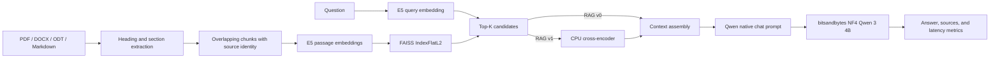

# RAG-FAISS: RAG v0/v1 with Qwen 3 4-bit

This repository is the historical Mistral RAG Chatbot project, migrated to a
single, public, prequantized Qwen answer model. It remains a small introductory
example for demonstrating:

- PDF, DOCX, ODT, and Markdown ingestion;
- deterministic chunking and source metadata;
- `intfloat/multilingual-e5-large` embeddings;
- FAISS top-K dense retrieval;
- **RAG v0**: vector-order context without reranking;
- **RAG v1**: optional cross-encoder reranking of the same candidates;
- grounded answer generation with Qwen 3 4B in genuine NF4 4-bit precision.

The repository is a teaching artifact, not a production service or an
implementation of Universal Hybrid RAG.

## Architecture



Passages and queries use the E5 `passage:` and `query:` prefixes. Vectors are
normalized before insertion into a flat L2 index, where L2 ordering is
equivalent to cosine-similarity ordering.

## Model

Default model:

```text
unsloth/Qwen3-4B-Instruct-2507-bnb-4bit
```

Properties:

- public Hugging Face repository, no account or token required;
- Apache 2.0 model license;
- approximately 2.66 GB of prequantized weights;
- bitsandbytes NF4 with BF16 compute and double quantization;
- loaded directly from its embedded quantization configuration;
- no dynamic full-precision conversion and no second copy of the weights.

The loader fails explicitly rather than silently falling back if CUDA,
bitsandbytes, device placement, or genuine 4-bit modules are unavailable.
CPU inference is not supported by this deployment path.

`MODEL_ID` may be changed to another compatible prequantized Hugging Face model
identifier, but the demo defaults to the model above. A legacy `model` field in
the search request is rejected; omit the field to use `MODEL_ID`.

## Hardware

Tested configuration:

- NVIDIA GeForce RTX 4080 SUPER, 16 GB;
- NVIDIA driver exposing CUDA 12.6;
- PyTorch 2.9.0+cu126;
- Transformers 4.57.6;
- Accelerate 1.10.1;
- bitsandbytes 0.50.2.

The Qwen model itself allocated about 2.5 GB after loading. During end-to-end
inference with the E5 embedder also resident, Qwen-side peak allocation was
about 8.1 GB; device-wide usage was about 15.6 GB. A 16 GB GPU is therefore the
verified target, not a guaranteed minimum.

## Quickstart

Prerequisites:

- Docker and Docker Compose;
- working NVIDIA driver and container runtime;
- a GPU with enough VRAM for Qwen 4-bit plus E5.

```bash
git clone https://github.com/miloskec/rag-faiss
cd rag-faiss
git switch book-ready/rag-v0-v1
cp .env.example .env
docker compose up -d --build
```

Build the synthetic index:

```bash
curl -X POST "http://127.0.0.1:5000/update-index?type=synthetic"
```

The first indexing run downloads the public E5 embedding model into
`./model-cache`.

Ask the first grounded question:

```bash
curl -sS -X POST "http://127.0.0.1:5000/search" \
  -H "Content-Type: application/json" \
  -d '{
    "query": "Which firmware version does Aster-100 require for calibration?",
    "context_type": "synthetic",
    "mode": "rag_v0",
    "top_k": 5
  }'
```

The first search downloads the approximately 2.66 GB Qwen model and then loads
it. Subsequent process starts reuse `./model-cache` and skip the download.

## Synthetic example

The corpus in `workspace/examples/synthetic_corpus/` is fictional:

- `aster-100.md`: firmware `2.4.0`;
- `aster-200.md`: firmware `3.1.0` with similar calibration language;
- `field-calibration.md`: generic calibration instructions.

The intended answer is:

> Aster-100 requires firmware version 2.4.0 for calibration.

An unrelated question should produce an abstention such as:

> The answer is not available.

The corpus does not represent real product specifications and is not a
retrieval-quality benchmark.

## RAG v0 and RAG v1

RAG v0:

```json
{
  "query": "Which firmware version does Aster-100 require for calibration?",
  "context_type": "synthetic",
  "mode": "rag_v0",
  "top_k": 5
}
```

RAG v1 uses the same candidates but passes explicit query-passage pairs through
a cross-encoder before context assembly:

```json
{
  "query": "Which firmware version does Aster-100 require for calibration?",
  "context_type": "synthetic",
  "mode": "rag_v1",
  "top_k": 5
}
```

The default reranker is
`cross-encoder/ms-marco-MiniLM-L-6-v2`, configured on CPU so it does not compete
with Qwen for VRAM. The first v1 request downloads the cross-encoder if it is
not cached.

The response contains:

- `retrieval_results`: original FAISS candidates and rank;
- `search_results`: final order used for context;
- `context`: exact source-labelled text sent to Qwen;
- `model_response`: concise generated answer;
- `metrics`: latency, token, throughput, model-load, and GPU-memory data;
- `model_runtime`: model ID and verified quantization details.

## Metrics

Every successful generation includes metrics such as:

```json
{
  "query_embedding_ms": 19.94,
  "vector_search_ms": 0.04,
  "rerank_ms": 0.0,
  "context_assembly_ms": 0.01,
  "model_load_ms": 0.0,
  "prompt_processing_ms": 1.35,
  "generation_ms": 1272.18,
  "llm_total_ms": 1274.0,
  "input_tokens": 330,
  "generated_tokens": 19,
  "generation_tokens_per_second": 14.93,
  "gpu_memory_allocated_mb": 6813.52,
  "gpu_peak_memory_mb": 8106.77,
  "total_request_ms": 1294.57
}
```

Ordinary logs contain timings and token counts, but not prompts, retrieved
document bodies, or Hugging Face tokens.

### Recorded verification

Measured on the RTX 4080 SUPER with the synthetic corpus and a 128-token
generation cap:

| Request | Wall time | Generation | Output tokens | Generation tokens/s |
| --- | ---: | ---: | ---: | ---: |
| RAG v0 cold, including E5 and Qwen load | 9.40 s | 1.82 s | 19 | 10.42 |
| RAG v0 warm 1 | 1.21 s | 1.19 s | 19 | 16.03 |
| RAG v0 warm 2 | 1.18 s | 1.16 s | 19 | 16.41 |
| RAG v0 warm 3 | 1.20 s | 1.18 s | 19 | 16.11 |
| RAG v1 cold, including cached cross-encoder | 7.84 s | 1.66 s | 19 | 11.45 |
| RAG v1 warm | 1.66 s | 1.23 s | 19 | 15.46 |

All warm requests were below the 15-second target and materially faster than
the historical multi-minute FP16 setup. The comparison is contextual, not a
matched benchmark.

The real v1 acceptance run used a cached multilingual BAAI cross-encoder to
avoid an unapproved additional model download. The application's default
MiniLM cross-encoder and the same `CrossEncoder` contract are covered by
deterministic tests.

## Verify genuine 4-bit loading

A successful search response includes:

```json
{
  "model_runtime": {
    "model_id": "unsloth/Qwen3-4B-Instruct-2507-bnb-4bit",
    "quantization": {
      "actual_4bit": true,
      "quant_method": "bitsandbytes",
      "quant_type": "nf4",
      "double_quant": true,
      "modules_4bit": 252,
      "quant_state_loaded": true,
      "bitsandbytes_version": "0.50.2"
    }
  }
}
```

The model is considered valid only when bitsandbytes 4-bit modules are actually
present. A configuration label alone is insufficient.

## Configuration

| Variable | Default | Meaning |
| --- | --- | --- |
| `HF_TOKEN` | empty | Optional Hugging Face token; not needed by default |
| `MODEL_ID` | `unsloth/Qwen3-4B-Instruct-2507-bnb-4bit` | Single answer model |
| `MODEL_LOCAL_FILES_ONLY` | `false` | Require an existing model cache |
| `RAG_MODE` | `rag_v0` | Default retrieval mode |
| `EMBEDDING_MODEL_NAME` | `intfloat/multilingual-e5-large` | Dense embedder |
| `EMBEDDING_DIMENSION` | `1024` | Required FAISS dimension |
| `RERANKER_MODEL_NAME` | cross-encoder MiniLM | RAG v1 reranker |
| `RERANKER_DEVICE` | `cpu` | Cross-encoder execution device |
| `RAG_TOP_K` | `5` | Default candidate count |
| `RAG_CHUNK_SIZE` | `1200` | Chunk character limit |
| `RAG_CHUNK_OVERLAP` | `150` | Chunk overlap |
| `RAG_MAX_CONTEXT_CHARS` | `6000` | Context character budget |
| `RAG_MAX_PROMPT_TOKENS` | `2048` | Prompt token limit |
| `RAG_MAX_NEW_TOKENS` | `128` | Generated-token limit |
| `RAG_LOG_DIR` | `workspace/logs` | Relative paths resolve from project root |
| `HOST` | `127.0.0.1` | Local bind address |
| `PORT` | `5000` | Flask port |
| `FLASK_DEBUG` | `false` | Flask debug mode |

The `model` search field is optional for backward API compatibility. Omit it,
use `default`, or use exactly the configured `MODEL_ID`. Any other value returns
an explicit error.

## Local Python execution

The local path still requires a CUDA-capable PyTorch installation and
bitsandbytes:

```bash
python3 -m venv .venv
source .venv/bin/activate
python -m pip install --upgrade pip
python -m pip install -r requirements.txt
cp .env.example .env
python workspace/app.py
```

Run tests without downloading model weights:

```bash
python -m pytest -q
```

## Docker persistence

- `./model-cache`: persistent Hugging Face cache.
- `./workspace`: code, documents, FAISS mappings, and indexes.
- Runtime images do not contain model weights or historical feed documents.

The pinned GPU base image is large. No-cache rebuilds are unnecessary for
normal use.

## Troubleshooting

**CUDA is unavailable**

Confirm `nvidia-smi`, the NVIDIA container runtime, and `docker run --gpus all`.
The application deliberately refuses CPU execution for this model.

**bitsandbytes import or CUDA setup fails**

Use the pinned image and requirements. Run:

```bash
docker run --rm --gpus all --entrypoint python3 \
  rag-faiss:book-ready -m bitsandbytes
```

**Insufficient VRAM**

Close other GPU workloads and verify free VRAM. The verified configuration
uses a 16 GB RTX 4080 SUPER.

**Model download is unavailable**

Verify access to the public Hugging Face model. When the files are already in
`model-cache`, set `MODEL_LOCAL_FILES_ONLY=true` to prohibit network access.

**Authentication error**

No token is needed for the default model. If a different private model is
configured, rotate any exposed token and set `HF_TOKEN` to the new value.

**FAISS dimension mismatch**

The index was generated with a different embedding configuration. Re-run
`/update-index` using the same embedding model and dimension.

## Tests

The deterministic suite covers ingestion, chunking, FAISS persistence, RAG
v0/v1 ordering, prompt construction, source mapping, API validation, model
cache reuse, explicit CUDA failure, native chat templating, generation settings,
and genuine 4-bit module detection. Heavy model weights are mocked in unit
tests.

## Limitations

- Heading detection is heuristic; scans and complex layouts are unsupported.
- Only one dense representation is used; there is no BM25 or SPLADE.
- Reranking cannot recover candidates omitted by FAISS.
- The default MiniLM reranker is English; Serbian reranking quality is not
  established.
- Context is traceable but evidence support is not formally verified.
- Prompt injection remains possible because retrieved text is untrusted input.
- Answer quality has not been benchmarked against a labelled dataset.
- The API lacks authentication, TLS, rate limiting, and production serving.

## Historical artifacts and licensing

The old PCI-DSS/DOC indexes remain under `workspace/legacy_artifacts/` as
history and are not loaded by the runtime.

The historical `ustav_republike_srbije.pdf` remains in repository history and
the local feed. Its provenance and redistribution terms remain unresolved.
Docker build context excludes `workspace/feed/` and `workspace/legacy_artifacts/`.

The Qwen model repository is Apache 2.0. The project README historically
declared MIT, but no repository-wide `LICENSE` file exists. Code and historical
document redistribution rights must be confirmed by the owner.
