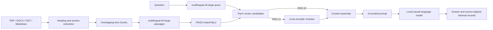

# Mistral RAG Chatbot

## What this repository demonstrates

This repository is the historical Mistral RAG Chatbot project, prepared as a
small introductory example for a book about Retrieval-Augmented Generation.
It demonstrates one dense-vector RAG pipeline with an optional cross-encoder
reranking stage.

The two educational modes share the same ingestion, chunking, embedding,
FAISS retrieval, context construction, prompting, and generation code:

- **RAG v0** sends FAISS candidates to context construction in vector-search
  order.
- **RAG v1** scores the same candidate pool with a cross-encoder and uses the
  new order for context construction.

Reranking can change the order of candidates that were already retrieved. It
does not increase the initial candidate pool's recall.

This is a book example and a local research service, not a production system
or an implementation of Universal Hybrid RAG.

## Architecture



Passages and queries use the E5 `passage:` and `query:` prefixes. Vectors are
normalized before insertion into a flat L2 index. For normalized vectors,
FAISS L2 ordering is equivalent to cosine-similarity ordering.

## Supported documents

- PDF: text extraction and heading heuristics through PyMuPDF.
- DOCX: paragraph extraction and Word heading styles through `python-docx`.
- ODT: paragraph extraction and heading styles through `odfpy`.
- Markdown and plain text: heading extraction for the synthetic corpus.

PDF and office-document chunking is heading-based followed by deterministic
overlap splitting. Heading detection is intentionally heuristic; complex
layouts, tables, scans, and OCR are outside this example.

## Synthetic example

The files in `workspace/examples/synthetic_corpus/` are fictional and are not
real product specifications. They contain:

- `aster-100.md`: firmware `2.4.0` is required for the synthetic Aster-100.
- `aster-200.md`: similar calibration language, but firmware `3.1.0` is
  required for Aster-200.
- `field-calibration.md`: a generic checklist that is relevant but not
  sufficient to choose a model-specific firmware.

The resolver currently yields nine chunks from these three files. One test
uses a deterministic token embedder and verifies that the Aster-100 firmware
chunk is returned first for the example question. That test verifies source
alignment and pipeline behavior; it is not a benchmark of E5 or the
cross-encoder.

## Prerequisites

- Python 3.10 or newer.
- A PyTorch installation compatible with the local CPU or GPU. Install the
  appropriate PyTorch build before the remaining requirements when using a
  GPU.
- Enough memory for the selected embedding and language models.
- Optional: Docker, Docker Compose, an NVIDIA driver, and the NVIDIA container
  runtime for the container workflow.

No model weights are committed to the repository.

## Local setup

```bash
python3 -m venv .venv
source .venv/bin/activate
python -m pip install --upgrade pip
# Install the PyTorch build appropriate for this machine first.
python -m pip install -r requirements.txt
cp .env.example .env
```

Run the deterministic test suite:

```bash
python -m pytest -q
```

Start the Flask application:

```bash
python workspace/app.py
```

The default local bind is `127.0.0.1:5000`. Set `HOST` only when remote access
is intentional.

## Model configuration

The selected answer model is initialized only when a query has retrieved
context. Set `MODEL_LOCAL_FILES_ONLY=true` to prohibit Hugging Face downloads
and require a complete local model directory.

| `MODEL` value | Hugging Face model | Local directory |
| --- | --- | --- |
| `mistral-7b-instruct` | `mistralai/Mistral-7B-Instruct-v0.3` | `mistral-7b-instruct/` |
| `llama-7b-hf` | `meta-llama/Llama-2-7b-chat-hf` | `llama-7b-hf/` |
| `qwen2.5-7b-instruct` | `Qwen/Qwen2.5-7B-Instruct` | `qwen2.5-7b-instruct/` |
| `sambalingo-chat` | `sambanovasystems/SambaLingo-Serbian-Chat` | `sambalingo-chat/` |

For a local container workflow, place weights in the corresponding
repository directory. The first use without local weights attempts a Hugging
Face download. Set `HF_TOKEN` only when the selected model or your account
requires authentication.

The default model is public `mistral-7b-instruct`. Llama 2 remains supported
but requires manual access approval on Hugging Face.

`HF_TOKEN` is the only Hugging Face authentication variable used by the
project. `rag_config.py` loads the project `.env` before Transformers and
Hugging Face modules are imported, and downloads receive the token explicitly.

When the tokenizer provides a chat template, the application uses it. The
fallback formats cover Llama 2, Mistral, ChatML, and SambaLingo-style prompts.
Question text is placed before retrieved context so tokenizer truncation
preserves the question.

Prompt preparation records whether special tokens were already inserted by a
chat template or fallback formatter. Those formatted prompts are tokenized
with `add_special_tokens=False` to avoid duplicate BOS/EOS markers.

## Docker workflow

The container image is built from a pinned base-image digest, and all Python
dependencies are installed during the image build rather than on every start.

```bash
mkdir -p llama-7b-hf mistral-7b-instruct qwen2.5-7b-instruct sambalingo-chat model-cache
cp .env.example .env
docker compose build
docker compose up
```

The service binds only to `127.0.0.1:5000`. The model directories are mounted
read/write so a first-run download can be cached. Review model licenses before
downloading or redistributing any weights.

The pinned GPU base image is large (tens of gigabytes after unpacking). The
local Python workflow avoids that image if GPU containerization is unnecessary.

## Build the synthetic index

```bash
curl -X POST "http://127.0.0.1:5000/update-index?type=synthetic"
```

Expected shape of the response:

```json
{
  "status": "updated",
  "type": "synthetic",
  "chunks_indexed": 9
}
```

The first run may download `intfloat/multilingual-e5-large`. The generated
FAISS index and JSON mapping are local runtime files and are ignored by Git.

Index updates are published as complete generations. The application builds
and validates a new FAISS/mapping pair first, then atomically updates one
generation manifest. A failed build or failed publication leaves the previous
active generation in use. Old generations are retained for manual inspection;
the example does not automatically prune them.

Other ingestion commands:

```bash
curl -X POST "http://127.0.0.1:5000/update-index?type=pdf"
curl -X POST "http://127.0.0.1:5000/update-index?type=doc"
```

PDF files are read from `workspace/feed/pdf/`. DOCX and ODT files are read
from `workspace/feed/doc/`.

## Search with RAG v0

```bash
curl -sS -X POST "http://127.0.0.1:5000/search" \
  -H "Content-Type: application/json" \
  -d '{
    "query": "Which firmware version does Aster-100 require for calibration?",
    "context_type": "synthetic",
    "mode": "rag_v0",
    "top_k": 5,
    "model": "mistral-7b-instruct"
  }'
```

The response contains:

- `retrieval_results`: initial FAISS candidates and their vector ranks.
- `search_results`: candidates in the order used for context.
- `context`: the exact source-labelled context passed to the prompt builder.
- `model_response`: generated text, or `null` when no context was found.
- `mode` and `status`.

Each retrieval result includes `source`, `chunk_id`, `title`, `text`, `page`
when available, vector distance, and ranking fields.

The context character limit includes source headers and the truncation marker.
When a passage must be shortened, the complete assembled context remains
within the configured `RAG_MAX_CONTEXT_CHARS` value.

## Search with RAG v1

Change the mode:

```bash
curl -sS -X POST "http://127.0.0.1:5000/search" \
  -H "Content-Type: application/json" \
  -d '{
    "query": "Which firmware version does Aster-100 require for calibration?",
    "context_type": "synthetic",
    "mode": "rag_v1",
    "top_k": 5,
    "model": "mistral-7b-instruct"
  }'
```

RAG v1 loads `cross-encoder/ms-marco-MiniLM-L-6-v2` and submits explicit
`(query, passage)` pairs. This is the stage that can reorder the same top-K
candidates. The corpus-wide recall is fixed by the preceding vector search.

The test suite uses a deterministic reranker double to verify pair structure
and candidate order. No cross-encoder quality or improvement claim is derived
from that test.

## API

| Method | Path | Purpose |
| --- | --- | --- |
| `GET` | `/health` | Process health check; does not load a model |
| `POST` | `/update-index?type=synthetic` | Rebuild from the synthetic corpus |
| `POST` | `/update-index?type=pdf` | Rebuild from `workspace/feed/pdf/` |
| `POST` | `/update-index?type=doc` | Rebuild from `workspace/feed/doc/` |
| `POST` | `/search` | Run RAG v0 or RAG v1 |
| `POST` | `/clean-resources` | Unload the cached language model |

`context_type` accepts `synthetic`, `pdf`, `doc`, `docx`, or `odt`. The three
office-document aliases use the DOC index.

Custom prompt templates may contain `{context}` and `{query}` placeholders.
The default prompt is preferred because it includes explicit grounding
instructions and preserves the question before the context.

## Configuration

| Variable | Default | Meaning |
| --- | --- | --- |
| `HF_TOKEN` | unset | Optional Hugging Face access token |
| `MODEL` | `mistral-7b-instruct` | Answer-model selection |
| `MODEL_LOCAL_FILES_ONLY` | `false` | Disallow Hugging Face downloads |
| `RAG_MODE` | `rag_v0` | Default retrieval mode |
| `EMBEDDING_MODEL_NAME` | `intfloat/multilingual-e5-large` | Dense embedder |
| `EMBEDDING_DIMENSION` | `1024` | Required FAISS dimension |
| `RERANKER_MODEL_NAME` | cross-encoder MiniLM | RAG v1 reranker |
| `RAG_TOP_K` | `5` | Default number of FAISS candidates |
| `RAG_CHUNK_SIZE` | `1200` | Maximum characters before overlap |
| `RAG_CHUNK_OVERLAP` | `150` | Character overlap |
| `RAG_MAX_CONTEXT_CHARS` | `6000` | Retrieval-context character budget |
| `RAG_MAX_PROMPT_TOKENS` | `2048` | Tokenizer prompt limit |
| `RAG_MAX_NEW_TOKENS` | `512` | Maximum generated tokens |
| `RAG_LOG_DIR` | `workspace/logs` | Log directory; relative paths resolve from the project root |
| `HOST` | `127.0.0.1` | Local Flask bind address |
| `PORT` | `5000` | Flask port |
| `FLASK_DEBUG` | `false` | Flask debug mode |

Changing the embedding model or dimension requires rebuilding both affected
indexes. Mismatched index dimensions fail explicitly.

## Troubleshooting

**`No context` is returned**

Build an index first and use the context type that matches it. A synthetic
index is stored in the PDF vector state for backwards-compatible retrieval
and is selected with `context_type: "synthetic"`.

**FAISS dimension mismatch**

The index was generated by a different embedding model. Re-run the relevant
`/update-index` request or restore a compatible index/mapping pair.

**Model download is blocked or unavailable**

Provide a complete local model directory, set `MODEL_LOCAL_FILES_ONLY=true`,
and configure `HF_TOKEN` only when downloading is allowed.

**GPU out-of-memory**

The causal language-model handler retries generation on CPU after a CUDA OOM.
This can be very slow and may still exceed system memory. Use the model and
hardware configuration documented by the model owner.

**Port 5000 is already in use**

Set `PORT` and adjust the published Docker port consistently.

## Educational limitations

- Heading detection is heuristic and does not perform layout-aware parsing,
  OCR of scanned PDFs, table extraction, or semantic chunking.
- One dense embedding representation is used. There is no BM25, SPLADE,
  multi-vector, query rewriting, adaptive routing, or knowledge graph.
- FAISS top-K recall bounds every later stage. Cross-encoder reranking cannot
  recover a passage that vector retrieval omitted.
- The default cross-encoder is an English MS MARCO model. Its behavior on
  non-English material is not established by this repository's tests.
- Context is limited by a character budget and then tokenizer truncation.
  Source headers help traceability but do not prove that an answer is fully
  supported.
- Retrieved text can contain prompt injection. The grounding instruction asks
  the model to use context as evidence, but this is not a security boundary.
- Generation is probabilistic and is not evaluated against a labelled answer
  set in this repository. Deterministic tests cover pipeline contracts, not
  semantic answer quality.
- The Flask service has no authentication, authorization, TLS termination, or
  production WSGI deployment. Keep it local unless those concerns are added.

These limitations are intentional starting points for later chapters about
hybrid retrieval, evidence evaluation, GraphRAG, and adaptive RAG.

## Historical artifacts and licensing

The old PCI-DSS/DOC indexes and mappings were moved, without deletion, to
`workspace/legacy_artifacts/`. They are historical evidence and are not loaded
by the corrected runtime. Their pickle mappings should not be loaded as
untrusted input.

The historical `ustav_republike_srbije.pdf` remains in the repository history
and feed directory. Its provenance and redistribution terms should be reviewed
before public distribution.

The Docker build context excludes `workspace/feed/` and
`workspace/legacy_artifacts/`, so the current image does not embed the
historical PDF or archived binary indexes. Compose still bind-mounts the local
workspace at runtime when a user intentionally indexes local documents.

The original README declared MIT licensing, but the repository does not contain
a `LICENSE` file. The author should confirm and add the authoritative license
before declaring the code or bundled documents redistributable. This document
does not invent ownership or permission for third-party material.

## Original project

Original repository: <https://github.com/miloskec/rag-faiss>

For further assistance, contact [Milos Kecman](https://miloskecman.online).
